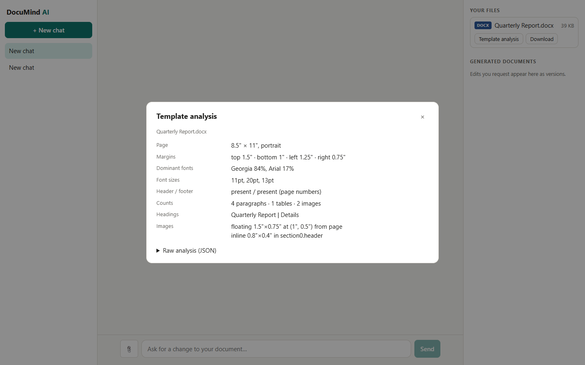

# DocuMind AI

A session-based, multi-agent chatbot that **reads, analyses, edits and generates Word, PowerPoint and Excel
documents while preserving their original design**, answers questions about uploaded files with **verifiable
citations**, and can research the **web** with clickable sources.



## What it does

| Capability | How |
|---|---|
| Multi-turn chat with attachments | FastAPI + SSE streaming; PostgreSQL stores conversations; LangGraph state is checkpointed per conversation |
| Analyse DOCX / PPTX / XLSX (and legacy `.xls`, `.potx`) | Deterministic analyzers extract layouts, styles, fonts, tables, placeholders, charts, merged cells... |
| Edit / generate while keeping the template's look | The LLM only emits a validated **Edit Plan**; renderers apply it to a copy of the *original* file; a preservation check re-analyses the result |
| Conversational editing with versions | "Change the title...", "add a row..."; every result is a downloadable version (v1, v2, ...) |
| Document Q&A (RAG) | Local `bge-small` embeddings + Pinecone; every `[n]` citation is verified against retrieved passages with exact locators (paragraph, slide, sheet rows, PDF page) |
| Web research with sources | Tavily, falling back to a multi-engine meta-search; URLs shown in chat and appended as a Sources section to generated documents |
| LangGraph workflow | route -> research -> understand -> plan -> validate (retry up to 3) -> render -> respond |

Design details: [docs/ARCHITECTURE.md](docs/ARCHITECTURE.md). Every defect found and fixed:
[docs/AUDIT.md](docs/AUDIT.md). Retrieval measurements: [docs/RAG_EVAL.md](docs/RAG_EVAL.md).

## Quick start with Docker (recommended)

Requires Docker Desktop and three free API keys.

```bash
cp .env.example .env          # Windows: copy .env.example .env
# edit .env: GROQ_API_KEY, PINECONE_API_KEY (and optionally TAVILY_API_KEY)
docker compose up --build
```

Open <http://localhost:8080>. The first build downloads CPU PyTorch and takes a while (10-25 min); later starts take seconds.
The first question about a document downloads the embedding model (~130 MB) once into a volume.

Compose serves plain HTTP, so it sets `COOKIE_SECURE=false`. Behind HTTPS, set it to `true`.

## Local development

Prerequisites: Python 3.12, Node 22 (22.12+ recommended), PostgreSQL 16.

```bash
# 1. Database
createdb documind_ai                      # or any empty database; set DATABASE_URL in .env

# 2. Backend
cd backend
python -m venv .venv && .venv/Scripts/activate        # Linux/macOS: source .venv/bin/activate
pip install -r requirements-dev.txt                   # runtime-only: requirements.txt
alembic upgrade head
uvicorn app.main:app --reload --port 8000

# 3. Frontend (new terminal)
cd frontend
npm install
npm run dev                                            # http://localhost:5173 (proxies /api to :8000)
```

### Configuration (`.env`, see `.env.example`)

| Variable | Purpose |
|---|---|
| `GROQ_API_KEY`, `GROQ_MODEL` | LLM (default `openai/gpt-oss-120b`) |
| `PINECONE_API_KEY`, `PINECONE_INDEX_NAME` | Vector store; index must be 384-d cosine (created automatically if absent) |
| `TAVILY_API_KEY` | Web search. Empty = fallback meta-search without a key |
| `DATABASE_URL` | PostgreSQL |
| `COOKIE_SECURE` | `true`/`false`; default secure only when `APP_ENV=production` |
| `MAX_UPLOAD_MB`, `MAX_FILES_PER_SESSION`, `MAX_SESSION_MB`, `MAX_CONCURRENT_CHATS` | Abuse limits |

Without a Groq key the app still starts but chat is disabled; without a Pinecone key retrieval uses an in-memory store (lost on restart). `GET /health` reports both.

## Using it

1. Click **New conversation** and attach a `.docx`, `.pptx`, `.xlsx`/`.xls` (or a PDF for Q&A).
2. The **template analysis** panel shows what was detected.
3. Ask, e.g.:
   * *"Retitle the document to Q3 Report and add a row for South: 15, 25."* -> new version, download it.
   * *"What was the total revenue for the year?"* -> answer with `[1]` chips that open the supporting passage.
   * *"Search the web for the latest ... and add a summary slide with sources."* -> slide + Sources.
4. Follow-ups ("make the title shorter") edit the latest version; earlier versions stay downloadable.

## Sample templates and outputs

* `sample_templates/` - our own demo templates (`acme_*`), plus a public SEC filing converted to docx/xls and an investor-deck PDF used for Q&A.
* `sample_outputs/` - for each demo template: the analysis, the **Edit Plan JSON**, the edited file, and the analysis of the edited file. Open the template and the `.edited` file side by side to compare.
* Regenerate everything (no LLM, no network; analyses and plans are identical every run, the binary files differ only by zip timestamps): `python -X utf8 -I backend/tools/make_samples.py`.

## Tests and quality gates

```bash
cd backend
pytest                          # ~375 tests, ~2.5 min; uses an isolated documind_ai_test database
pytest --runslow tests/test_rag_eval.py    # real embedding model retrieval eval
ruff check .
alembic check                   # models and migrations agree
cd ../frontend
npx vitest run && npm run lint && npm run build
```

The default test run never calls Groq or the real embedder. A few tests hit live Pinecone/Tavily and skip themselves when no key is configured (a fresh clone without `.env` runs 367 passed / 11 skipped). Live end-to-end checks are in `backend/tools/`
(`e2e_live.py`, `rag_e2e.py`, `web_e2e.py`, `ui_e2e.py`); they need real keys.

## Security notes

Uploads are validated by extension *and* content (macros rejected, zip-bomb/zip-slip/XXE limits). Sessions are scoped to an
anonymous httpOnly cookie. Document and web text is treated as untrusted data in prompts. The server never fetches web
result pages. Details in [docs/ARCHITECTURE.md](docs/ARCHITECTURE.md#security-model).

## Known limitations

* The free Groq tier caps every model at 8,000 tokens/minute; very large documents are summarised into a compact outline for planning, and heavy use will be rate-limited (the app waits and retries).
* XLSX edits via openpyxl lose drawing shapes and sparklines (charts, images, tables, conditional formats survive); such files are flagged before editing.
* Scanned PDFs (images only) have no text layer, so Q&A cannot read them.
* No user accounts: identity is an anonymous browser cookie.

## Windows notes

* If `npm run build` fails with a missing native binding: `npm install --no-save @rolldown/binding-win32-x64-msvc@1.2.16 @oxlint/binding-win32-x64-msvc@1.92.0`.
* Vite listens on IPv6 `localhost`; use `http://localhost:5173`, not `127.0.0.1`.
* Run scripts with `python -X utf8 -I` to avoid console-encoding errors.

## License

[MIT](LICENSE). The sample SEC filing and investor deck in `sample_templates/` are public documents of their respective companies and are not covered by this license.
